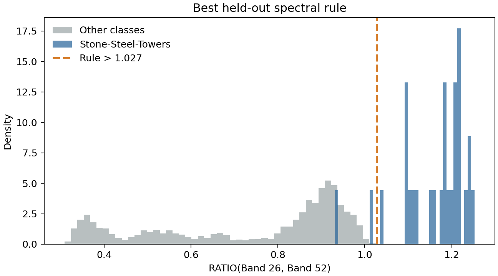

# SpecRule

Reproducible code for **SpecRule: Automated Discovery of Interpretable Spectral Rules for Hyperspectral Classification**. SpecRule searches simple band ratios and normalized-difference spectral indices (NDSIs), then chooses a transparent one-threshold rule for each land-cover class.



## Rule family

For two bands, (B_i) and (B_j), the implemented features are:

```text
Ratio = B_i / B_j
NDSI  = (B_i - B_j) / (B_i + B_j)
```

Small denominators are guarded, so both features remain finite. For every candidate feature and target class, SpecRule evaluates `feature <= threshold` and `feature > threshold`, including endpoint rules that predict every sample positive or negative, and selects by positive-class F1 and then accuracy with deterministic tie-breaking.

## Installation

Python 3.10 or newer is required.

```bash
python -m venv .venv
source .venv/bin/activate
pip install -e .
```

For development:

```bash
pip install -r requirements.txt
pytest -q
```

## Quick start

Run a bounded, reproducible search over 256 candidate band pairs:

```bash
specrule \
  --config configs/indian_pines.json \
  --max-pairs 256 \
  --output-dir outputs/indian_pines
```

The command excludes background label 0, makes a seed-controlled stratified 70/30 discovery/held-out split, and writes:

- `discovered_rules.csv`: one best rule for each of the 16 labeled classes;
- `rule_diagnostic.png`: the strongest discovered class-versus-rest rule.

A verified result snapshot is committed at [`results/discovered_rules.csv`](results/discovered_rules.csv).

## Interpreting the snapshot

The bounded 256-pair smoke search selects each rule only on the 70% discovery partition. The committed CSV reports `discovery_f1`/`discovery_accuracy` separately from `heldout_f1`/`heldout_accuracy` on the untouched 30% partition. The figure ranks rules using held-out F1. These are newly rerun repository smoke results, not replacements for the companion paper's larger candidate search or its reported rules.

## Layout

```text
configs/        experiment paths and seed
data/           compact Indian Pines source files
assets/         README figure
results/        small verified result snapshot
src/specrule/   features, search, evaluation, plotting, and CLI
tests/          numerical and behavioral tests
outputs/        ignored generated artifacts
```

## Reproducibility notes

- Candidate bands are selected deterministically across the available spectral range.
- Search results do not depend on dictionary or filesystem order.
- Class 0 is treated as unlabeled background and excluded from rule fitting.
- The configured seed fixes the stratified discovery/held-out split.
- The committed MAT files allow the documented command to run without a separate download.

## Related projects

- [SpecLite](https://github.com/khkim1729/SpecLite) evaluates fourfold spectral reduction.
- [SpecFusion](https://github.com/khkim1729/SpecFusion) combines raw spectra with physics-guided descriptors and sensor-validity masks.

## License

MIT
